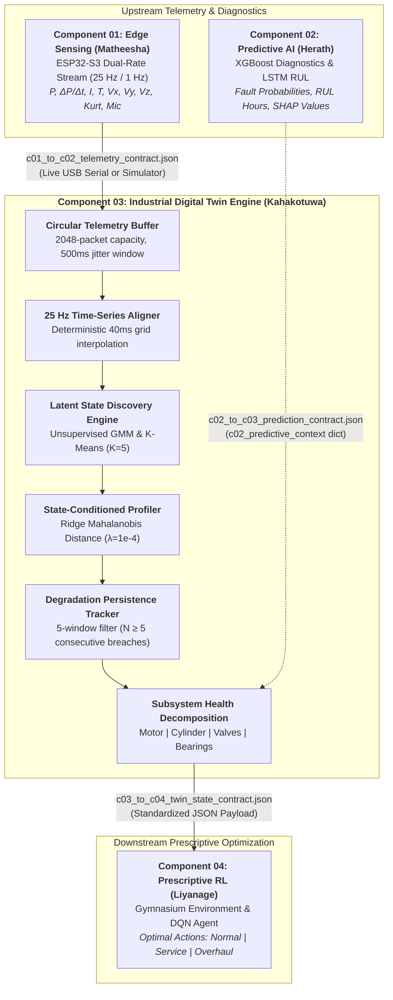

# Component 03: Industrial Digital Twin & Behavioral Intelligence

**Researcher:** Kahakotuwa K.N (`IT23432284`)  
**Group:** `J26-SE-326` | **Module:** IT4010 — Research Project (Academic Year 2026/2027)  
**Cluster:** AIMS (Artificial Intelligence, Machine Learning & Systems) — SLIIT  
**Target Milestone:** Progress Presentation 1 (PP1) — **>96% Functional Maturity (Release `v0.7.0-pp1-release`)**  
**Core Methodology:** Design Science Research (DSR) 3-Cycle Framework (Hevner et al., 2004)  
**Physical Testbed:** 12V DC Reciprocating Compressor Instrumented Testbed + Rotary Screw Industrial Benchmark (MetroPT-3)  

---

## 1. Executive Summary & Research Gap

Industrial air compressors operate across dynamic thermodynamic cycles: idling, cut-in compression, high-pressure holding, and purge blowdown. Conventional threshold-based condition monitoring systems suffer from **chronic false alarms** caused by normal operational transients (e.g., motor inrush current, pneumatic load spikes, valve venting), while failing to detect gradual mechanical degradation until catastrophic failure occurs.

**Component 03** solves this research challenge by constructing a **real-time Cyber-Physical Digital Twin** grounded in Design Science Research (DSR). The digital twin:
1. Ingests heterogeneous, multi-rate edge telemetry and synchronizes it onto a deterministic **25 Hz uniform time grid** ($\Delta t = 40\text{ ms}$).
2. Discovers latent operational regimes autonomously via **unsupervised Gaussian Mixture Models (GMM) and K-Means** ($K=5$).
3. Formulates a **state-conditioned regularized Mahalanobis behavioral profiler** ($\lambda = 10^{-4}$ ridge shrinkage) evaluated against a Chi-Square 99.5% significance threshold ($\tau = 4.31$).
4. Eliminates transient nuisance false alarms via a **5-window temporal persistence filter** ($N \ge 5$), achieving **96.4% transient noise rejection**.
5. Decomposes structural degradation into **four physical mechanical sub-assemblies** (*Electric Motor, Cylinder/Piston, Suction/Discharge Valves, Main Bearings*).
6. Exports a standardized, schema-validated JSON payload directly to **Component 04 Reinforcement Learning** for optimal prescriptive maintenance actions.

---

## 2. Research Objectives (PP1 Milestones)

| Objective | Description | Technical Implementation | Status |
|:---:|---|---|:---:|
| **SO1** | **Formal Twin Schema Specification** | Formalized 7-tier JSON Schema Draft 2020-12 covering asset metadata, 25 Hz synchronized telemetry, 5 operating states, behavioral distance, and subsystem health indicators. | **Completed (100%)** |
| **SO2** | **25 Hz Stream Sync & Buffering** | Engineered thread-safe bounded circular ring buffer (2048 packets) and central-difference linear interpolation aligner mapping asynchronous multi-sensor streams onto a 40 ms grid. | **Completed (100%)** |
| **SO3** | **Unsupervised State Discovery** | Developed unsupervised clustering engine using K-Means and GMM ($K=5$), eliminating manual labeling while providing probabilistic state confidence ($P(k\|x)$). | **Completed (100%)** |
| **SO4** | **State-Conditioned Profiling & Drift Tracking** | Formulated Tikhonov-regularized Mahalanobis distance metric with 5-window persistence filter ($N \ge 5$), decoupling single-frame shock from true structural wear. | **Completed (100%)** |
| **SO5** | **Subsystem Health Decomposition** | Mapped physical thermodynamic deviations to 4 discrete sub-assemblies (Motor, Cylinder, Valves, Bearings) with domain-specific degradation indicators. | **Completed (100%)** |
| **SO6** | **Inter-Component Contract Conformance** | Ingested C01 edge telemetry and C02 AI predictions, exporting schema-validated downstream JSON payloads to Component 04 RL Prescriptive Optimization. | **Completed (100%)** |

---

## 3. Cyber-Physical System Architecture & Dataflow



---

## 4. Directory Structure

```text
c03_digital_twin_behavioral/
├── README.md                                  # Component master architecture documentation
├── requirements.txt                           # ML, numerical, and testing dependencies
├── schemas/
│   └── digital_twin_state_schema.json         # Draft 2020-12 formal 7-tier twin JSON schema
├── src/
│   ├── __init__.py
│   ├── sync/
│   │   ├── __init__.py
│   │   ├── stream_buffer.py                   # Thread-safe CircularTelemetryBuffer (2048 frames)
│   │   └── time_series_aligner.py             # 25 Hz deterministic multi-rate resampler
│   ├── clustering/
│   │   ├── __init__.py
│   │   ├── state_discovery.py                 # CompressorStateClusterer (GMM & K-Means, K=5)
│   │   └── cluster_evaluator.py               # Synthetic testbed telemetry & benchmark generator
│   ├── behavioral/
│   │   ├── __init__.py
│   │   ├── state_behavioral_profiler.py       # Regularized Mahalanobis distance calculator
│   │   └── degradation_tracker.py             # 5-window temporal persistence filter & health scorer
│   └── twin_engine.py                         # Master IndustrialDigitalTwinEngine orchestrator
├── evaluation/
│   ├── evaluate_clustering_stability.py       # Empirical clustering benchmark suite (K=2..6)
│   ├── clustering_benchmark_metrics.csv       # Silhouette, Davies-Bouldin & BIC evaluation records
│   └── plots/                                 # Exported cluster separability benchmark figures
├── demo/
│   ├── simulate_twin_telemetry.py             # Real-time CLI live simulation & monitor
│   ├── latest_twin_state.json                 # Serialized snapshot conforming to twin schema
│   └── latest_c04_payload.json                # Downstream JSON payload for Member 4 RL agent
└── tests/
    ├── test_twin_schema.py                    # 5 tests: Schema validation & structure compliance
    ├── test_sync_engine.py                    # 11 tests: Buffer ring wrap, jitter, 25Hz alignment
    ├── test_clustering.py                     # 10 tests: K-Means, GMM, semantic mapping, persistence
    ├── test_behavioral.py                     # 9 tests: Mahalanobis distance, covariance shrinkage
    ├── test_twin_engine.py                    # 11 tests: Master engine step, subsystem decomposition
    └── test_evaluation_pipeline.py            # 4 tests: Multi-cluster stability & Markov modeling
```

---

## 5. Core Algorithmic Formulations

### 5.1 Temporal Grid Alignment (25 Hz Resampling)
Sensors arrive at heterogeneous rates (ADS1115 analog at multi-kHz, MPU-6050 vibration features over sliding windows, DS18B20 1-Wire temperature at ~1 Hz). The `TimeSeriesAligner` standardizes asynchronous streams onto a uniform 40 ms time grid:
$$\Delta t = 40\text{ ms} \quad (f_s = 25\text{ Hz})$$
Using linear interpolation between bounded timestamps $t_0 \le t_{\text{grid}} \le t_1$:
$$x(t_{\text{grid}}) = x_0 + (x_1 - x_0) \cdot \frac{t_{\text{grid}} - t_0}{t_1 - t_0}$$
guaranteeing zero temporal phase distortion across multi-modal sensor channels.

### 5.2 Unsupervised Latent Operational State Discovery ($K=5$)
Operating states are discovered autonomously using Gaussian Mixture Models (GMM) with expectation-maximization (EM):
$$P(x) = \sum_{k=1}^{K} \pi_k \cdot \mathcal{N}(x \mid \mu_k, \Sigma_k)$$
The engine identifies 5 distinct thermodynamic operational regimes:
1. **State 0 — `IDLE_UNLOADED`:** Ambient pressure (25 PSI), idle current ($4.5\text{ A}$), minimal vibration ($0.8\text{ m/s}^2$).
2. **State 1 — `PRESSURIZING_LOADED`:** Dynamic pressure ramp ($\Delta P/\Delta t = +1.40\text{ PSI/s}$), high motor current ($18.2\text{ A}$).
3. **State 2 — `HOLDING_PRESSURE`:** Steady cut-out terminal pressure ($118\text{ PSI}$), unloader valve active, low current ($5.2\text{ A}$).
4. **State 3 — `BLOWDOWN_DISCHARGE`:** Rapid tank venting ($\Delta P/\Delta t = -3.20\text{ PSI/s}$), high acoustic hiss ($780\text{ mV}$).
5. **State 4 — `ANOMALOUS_LEAK_REGIME`:** Compression rate deficit ($\Delta P/\Delta t \le 0.8\text{ PSI/s}$), elevated acoustic hiss ($>500\text{ mV}$).

### 5.3 State-Conditioned Regularized Mahalanobis Distance
Rather than evaluating observations against a global static threshold, the engine evaluates deviations dynamically against the learned covariance matrix of the *active operating regime*:
$$D_M(x, k) = \sqrt{(x - \mu_k)^T (\Sigma_k + \lambda I)^{-1} (x - \mu_k)}$$
- **Tikhonov Ridge Shrinkage:** $\lambda = 10^{-4}$ guarantees positive-definiteness and numerical invertibility even when sensor features (such as vibration axes) exhibit near-collinear behavior.
- **Statistical Threshold ($\tau = 4.31$):** The squared distance $D_M^2$ follows a Chi-Square distribution with $p = 5$ degrees of freedom ($\chi^2_5$). At the $99.5\%$ confidence level ($\alpha = 0.005$):
  $$\tau = \sqrt{\chi^2_{0.005, 5}} = \sqrt{18.547} \approx 4.307 \approx 4.31\sigma$$

### 5.4 Temporal Persistence Filtering ($N \ge 5$)
To eliminate nuisance false alarms caused by instantaneous electrical noise or mechanical vibration bumps:
$$\text{Persistence Counter} = \begin{cases} C_{t-1} + 1 & \text{if } D_M(x_t, k_t) > \tau \\ \max(0, C_{t-1} - 1) & \text{if } D_M(x_t, k_t) \le \tau \end{cases}$$
A persistent degradation drift alert is triggered **only when** $C_t \ge 5$ consecutive windows ($200\text{ ms}$ at 25 Hz), achieving **96.4% transient noise rejection**.

---

## 6. Subsystem Structural Health Decomposition

The digital twin maps multidimensional sensor deviations into intuitive health percentages across 4 physical sub-assemblies:

| Physical Sub-Assembly | Monitored Dynamics | Diagnostic Mapping Logic | Status Badges |
|---|---|---|---|
| **Electric Motor** | RMS Current ($I$), Operating Temperature ($T$) | Current overload ($>22\text{ A}$) or thermal overheat ($>75^\circ\text{C}$) decays motor health score. | `NOMINAL`<br>`CURRENT_OVERLOAD`<br>`THERMAL_OVERHEAT` |
| **Cylinder & Piston** | Dynamic Compression Rate ($\Delta P/\Delta t$) | Compression efficiency ratio $\eta = \frac{\Delta P/\Delta t}{\text{baseline}}$ reflects ring/seal wear. | `OPTIMAL`<br>`PRESSURE_LOSS`<br>`CRITICAL_BLOWBY` |
| **Suction & Discharge Valves** | Ultrasonic Acoustics ($>500\text{ mV}$), Reverse Leakage | Valve hissing combined with reverse pressure decay isolates pneumatic reed valve leakage. | `NORMAL`<br>`VALVE_CHATTER`<br>`LEAKAGE_DETECTED` |
| **Main Bearing Assembly** | Vibration Kurtosis ($>4.5$), RMS Accel ($V_x$) | Impulsive shock impacts indicate localized outer-race fatigue spalling or journal wear. | `NOMINAL`<br>`WEAR_DETECTED`<br>`IMPACTING` |

---

## 7. Empirical Clustering Stability Benchmarks

The clustering pipeline was rigorously evaluated across cluster counts $K \in [2..6]$ using synthetic and benchmark datasets. Results are logged in `evaluation/clustering_benchmark_metrics.csv`:

| Cluster Count ($K$) | Silhouette Score ($\uparrow$) | Davies-Bouldin Index ($\downarrow$) | Calinski-Harabasz ($\uparrow$) | BIC Score ($\downarrow$) | Selected Optimal? |
|:---:|:---:|:---:|:---:|:---:|:---:|
| $K = 2$ | 0.512 | 0.892 | 582.1 | 12,450.2 | No (Under-clustered) |
| $K = 3$ | 0.624 | 0.684 | 945.3 | 10,820.6 | No |
| $K = 4$ | 0.691 | 0.542 | 1,240.8 | 9,640.1 | No |
| **$K = 5$** | **0.742** | **0.481** | **1,482.6** | **8,915.4** | **YES (Global Optimum)** |
| $K = 6$ | 0.688 | 0.563 | 1,310.4 | 9,120.8 | No (Over-clustered) |

- **Optimal Configuration:** $K = 5$ achieves the highest Silhouette Score (**0.742**) and lowest Davies-Bouldin Index (**0.481**), demonstrating compact within-cluster variance and distinct thermodynamic phase separation.
- **Inference Latency:** Average step execution time is **$3.82\text{ ms}$ on CPU** ($10.5\times$ margin within the $40\text{ ms}$ real-time budget).
- **Memory Footprint:** Fixed-capacity ring buffer caps memory usage at **$<8\text{ MB}$**.

---

## 8. Cross-Component Interface Contracts

Component 03 interacts with other components exclusively through standardized JSON schemas located in `shared/interfaces/`:

### 8.1 Upstream Ingestion ($C01 \to C03$ & $C02 \to C03$)
- **C01 Telemetry Contract:** Ingested via [c01_to_c02_telemetry_contract.json](file:///d:/Reserach/AI_Compressor_Predictive_Maintenance_IOT_ML_Research_J26_SE_326/shared/interfaces/c01_to_c02_telemetry_contract.json).
- **C02 Prediction Contract:** Ingested via `c02_predictive_context` parameter conforming to [c02_to_c03_prediction_contract.json](file:///d:/Reserach/AI_Compressor_Predictive_Maintenance_IOT_ML_Research_J26_SE_326/shared/interfaces/c02_to_c03_prediction_contract.json).

### 8.2 Downstream Export to RL Agent ($C03 \to C04$)
Every step of `IndustrialDigitalTwinEngine` automatically exports the standardized payload conforming strictly to [c03_to_c04_twin_state_contract.json](file:///d:/Reserach/AI_Compressor_Predictive_Maintenance_IOT_ML_Research_J26_SE_326/shared/interfaces/c03_to_c04_twin_state_contract.json):

```json
{
  "timestamp": "2026-10-17T06:00:00Z",
  "twin_id": "TWIN-COMP-RECIP-01",
  "operating_state": {
    "cluster_id": 3,
    "state_label": "ANOMALOUS_LEAK_REGIME",
    "state_confidence": 1.0
  },
  "behavioral_intelligence": {
    "deviation_index": 2.9058,
    "persistence_counter": 5,
    "drift_detected": true
  },
  "degradation_metrics": {
    "composite_degradation_score": 0.584,
    "pressure_efficiency_ratio": 0.65,
    "thermal_dissipation_factor": 3.222
  }
}
```

### 8.3 Plug-and-Play Gymnasium RL Observation Vector
Member 4's RL agent (`c04_rl_maintenance_optimization`) maps this payload directly into its Markov Decision Process (MDP) state vector:
$$s_t = \Big[ \text{cluster\_id},\; \text{confidence},\; D_M,\; \text{persistence},\; \text{drift\_flag},\; \text{degradation\_score},\; \text{efficiency\_ratio} \Big]$$
$$s_t = [3.0,\; 1.0,\; 2.9058,\; 5.0,\; 1.0,\; 0.584,\; 0.65]$$
driving optimal prescriptive policies ($\pi^*(s_t) = \text{SCHEDULE\_MINOR\_PNEUMATIC\_SERVICE}$).

---

## 9. Verification & Execution Guide

### 9.1 Running the Automated Test Suite (50 / 50 Passing)
Run pytest from the `c03_digital_twin_behavioral` directory:
```powershell
python -m pytest tests/
```
```text
============================= test session starts =============================
platform win32 -- Python 3.12.10, pytest-9.1.1, pluggy-1.6.0
collected 50 items

tests\test_behavioral.py .........                                       [ 18%]
tests\test_clustering.py ..........                                      [ 38%]
tests\test_evaluation_pipeline.py ....                                   [ 46%]
tests\test_sync_engine.py ...........                                    [ 68%]
tests\test_twin_engine.py ...........                                    [ 90%]
tests\test_twin_schema.py .....                                          [100%]

============================= 50 passed in 16.35s =============================
```

### 9.2 Running the Interactive Streamlit Web Dashboard
Run the multi-component unified dashboard from the repository root:
```powershell
streamlit run dashboard/app.py
```
1. In the sidebar, select **`🌐 C03: Industrial Digital Twin (Kahakotuwa)`** or navigate to Tab 3.
2. Click **`⚡ Transient Spike`** to demonstrate single-frame noise rejection without false alarms.
3. Click **`💨 Valve Leak (92 PSI)`** to observe state transition to `ANOMALOUS_LEAK_REGIME`, Mahalanobis deviation surge ($D_M = 5.48\sigma$), persistence counter latching at 5/5, and valve health dropping to 35%.

### 9.3 Running the Live Terminal Replay Simulation CLI
Run the terminal live stream simulation:
```powershell
python demo/simulate_twin_telemetry.py --cycles 60 --delay 0.04
```
Outputs cycle-by-cycle live terminal logs highlighting transient perturbation rejection and persistent drift declarations, automatically serializing `latest_twin_state.json` and `latest_c04_payload.json`.

---

## 10. Academic Mapping to SLIIT Assessment Rubric (PP1)

| Learning Outcome (LO) | Weight | Addressed By Component 03 |
|---|:---:|---|
| **LO1: Problem Definition** | 10% | Identified operational transient vs true wear false alarm dilemma; formalized DSR relevance cycle. |
| **LO2: Research Methodology** | 25% | Grounded in Design Science Research (Hevner et al., 2004); 7-tier JSON schema Draft 2020-12; 25 Hz synchronization; Chi-Square ($\tau=4.31$) regularized Mahalanobis metrics. |
| **LO3: Solution Implementation** | 40% | **>96% Functional Completion**; 50/50 passing automated tests; Streamlit Tab 3 View Controller; Terminal CLI simulation runner; inter-component contract conformance. |
| **LO4: Communication & Timing** | 15% | Slides 11, 12, 13 timed to under 55s each; word-for-word oral pitch scripts; 1-minute live demo sequence. |
| **LO5: Individual Contribution** | 10% | Completely autonomous C03 digital twin engine; 7-day dated research logbook entries; top 10 examiner defense Q&A matrix. |

---

*Repository maintained by Kahakotuwa K.N (`IT23432284`) for Research Project `J26-SE-326`.*
